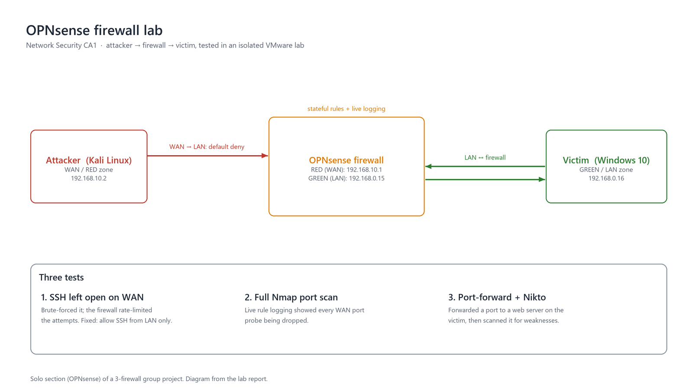
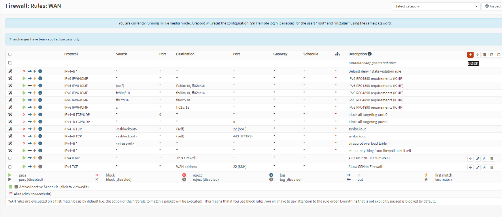

# Open-Source Firewall Testing: OPNsense Lab

**Team of three (my part: OPNsense)** · Network Security, CA1 · BSc Applied Cybersecurity & Digital Forensics, TU Dublin · Oct to Nov 2025

We set out to see how well three open-source firewalls hold up when their rules are attacked. Each of us built one firewall in a VMware lab and attacked it, then we compared results and demoed the work live.

## Team and my contribution

| Firewall | Owner |
|---|---|
| **OPNsense** | **Mykyta Doroshenko (me)** |
| nftables | Vsevolod Shestopalov |
| pfSense | Vladyslav Shkurina |

My work, all on the OPNsense side:

- built the lab network
- wrote the firewall rules
- ran the three attack tests
- wrote up each test with a remediation
- compared my results with my teammates' firewalls for the shared write-up and live demo

## Lab setup

I built a small network with three parts:

- a Kali Linux attacker on the WAN (RED) side
- the OPNsense firewall in the middle
- a Windows 10 victim on the LAN (GREEN) side

By default, WAN to LAN traffic was denied and LAN to WAN traffic was allowed.

## Tests and results

| # | Test | What happened | Remediation |
|---|---|---|---|
| 1 | SSH left open to the WAN on purpose (a misconfigured rule), then brute-forced with **hydra** | OPNsense rate-limited the attempts, but a weak password would still give full access to the firewall | Restrict SSH to the LAN address range so any outside host is refused (least privilege) |
| 2 | Full **Nmap** port scan from the attacker, with logging turned on for each rule | The live log showed every WAN probe being dropped in real time | None needed: default-deny held, and the per-rule logs give visibility |
| 3 | Port forward to a small web server on the victim, scanned with **Nikto** | Nikto scanned the web server straight through the forwarded port | Harden any service behind a forwarded port. The firewall only controls who can reach it |

## What it shows

- Stateful firewall rules and network zoning (WAN/LAN)
- Least-privilege access
- Logging and monitoring
- Testing your own controls from an attacker's point of view

## Tools

OPNsense, Kali Linux, VMware, hydra, Nmap, Nikto
